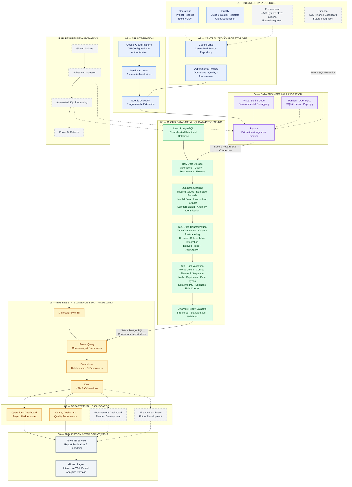

# 🚀 Subsea Project Management Dashboard

### [▶ LAUNCH INTERACTIVE DASHBOARD](https://hafizsuib3.github.io/subsea-project-management-dashboard/)

Explore the interactive dashboard directly in your browser. Navigate between reporting sections, analyze key performance indicators (KPIs), apply dynamic filters, and interact with data visualizations.

**No Power BI Desktop installation is required.**

---

# Subsea Project Management Dashboard

### An End-to-End Data Engineering, Business Intelligence & Project Management Analytics Portfolio

An interactive Data Engineering and Business Intelligence portfolio project designed to demonstrate the integration of departmental business data, API-based data extraction, Python data ingestion, cloud database management, SQL-based data cleaning, transformation, validation, data modelling, and interactive dashboard development.

The project utilizes Google Drive, Google Cloud Platform, Google Drive API, Python, Visual Studio Code, Neon PostgreSQL, SQL, Power Query, DAX, and Microsoft Power BI within a centralized and scalable analytics architecture.

The project showcases the development of data-driven reporting solutions to support operational visibility, project performance monitoring, cross-functional business analytics, and management decision-making.

---

## 🔐 Disclaimer — Data Confidentiality & Privacy

This repository is intended exclusively as a professional portfolio demonstrating capabilities in Data Engineering, Business Intelligence, Data Analytics, API Integration, Cloud Database Management, and Dashboard Development.

Company-sensitive information, including confidential operational records, commercial figures, personal information, and proprietary business data, must be anonymized, removed, or replaced with synthetic data before public publication.

Database credentials, API authentication keys, service account credentials, and sensitive configuration information must be securely managed and excluded from public repositories.

The publicly accessible dashboard is intended for demonstration purposes and should not be interpreted as an official corporate reporting platform.

---

## 🚧 Development Status — Work in Progress

This dashboard is an ongoing portfolio project and is continuously being developed, refined, and enhanced.

As development progresses, certain dashboard pages, features, visualizations, data integrations, or functionalities may remain incomplete, undergo modifications, or occasionally experience errors.

Improvements, bug fixes, additional features, database integrations, data processing capabilities, data model refinements, pipeline automation, and performance optimizations will be implemented progressively.

The project will continue to evolve, reflecting continuous learning, practical problem-solving, and the ongoing development of Data Engineering, Business Intelligence, and Data Analytics capabilities.

**Thank you for your understanding and interest in following the project's progress.**

---

## 📊 Project Overview

Subsea Engineering Project Management in IRM (Inspection, Repair and Maintenance) is the systematic planning, engineering, coordination, execution, monitoring, and control of underwater intervention projects to maintain the integrity, safety, reliability, and operational performance of subsea assets, particularly in the offshore oil and gas industry.

Subsea Analytics is an end-to-end Data Engineering and Business Intelligence portfolio project designed to demonstrate how business information from multiple departmental sources can be integrated into a centralized cloud-based analytics environment.

The project focuses on integrating operational records, quality management information, procurement system data, and financial information into a structured reporting platform.

The architecture incorporates centralized source data storage through Google Drive, programmatic data extraction through the Google Drive API, and Python-based data ingestion developed using Visual Studio Code.

Neon PostgreSQL provides the centralized cloud database environment for structured data storage, SQL-based data cleaning, transformation, standardization, and validation.

Microsoft Power BI connects directly to Neon PostgreSQL through its native database connector, supporting data modelling, analytical calculations, interactive reporting, and business performance monitoring.

The modular architecture provides a foundation for scalable departmental integration, automated data pipelines, and cross-functional business intelligence.

---

## 🏢 Business Data Sources & Departmental Integration

The project is designed to progressively integrate multiple business functions into a unified analytics environment.

| Department | Data Source | Analytical Scope | Integration Status |
|---|---|---|---|
| Operations | Project records, Excel and CSV datasets | Project performance, progress, delivery, operational KPIs | PostgreSQL integrated |
| Quality | Quality registers, audit records and client satisfaction surveys | Quality performance, audits, compliance and client satisfaction | Progressive development |
| Procurement | NAVA System / ERP exports | Procurement activities, purchasing performance and supplier analytics | Planned integration |
| Finance | SQL Finance Dashboard / Financial database | Financial performance, expenditure, budget and cost analysis | Future integration |

Departmental data integrations and analytical capabilities will be expanded progressively as the project develops.

---

## 🛠️ Technology Stack

| Technology | Application |
|---|---|
| Google Drive | Centralized file-based source data storage |
| Google Cloud Platform | API configuration and service account management |
| Google Drive API | Programmatic data extraction and source connectivity |
| Python | Data extraction, ingestion and pipeline development |
| Visual Studio Code | Code development, scripting and debugging |
| Pandas | Dataset extraction, reading and data handling |
| OpenPyXL | Excel dataset processing |
| SQLAlchemy | Database connectivity and data ingestion |
| Psycopg | PostgreSQL database connectivity |
| Neon PostgreSQL | Centralized cloud-hosted relational database |
| SQL | Data cleaning, transformation, standardization, validation and database management |
| PostgreSQL Views | Structured reporting datasets and dynamic data validation |
| Microsoft Excel | Departmental source data preparation |
| NAVA System | Planned procurement system integration |
| SQL Finance Dashboard | Future financial data integration |
| Power Query | Database connectivity and supplementary data preparation |
| DAX | Analytical calculations, KPIs and performance measures |
| Microsoft Power BI | Data modelling and interactive dashboard development |
| Power BI Service | Online report publication and embedding |
| GitHub | Source code management, documentation and version control |
| GitHub Pages | Web-based interactive dashboard portfolio |
| GitHub Actions | Planned data pipeline automation |

---

## 🔄 End-to-End Data Architecture

### End-to-End Cloud-Based Business Intelligence Architecture

The following diagram illustrates the intended architecture, including progressively developed SQL processing capabilities and future departmental integrations.

*The diagram represents the intended end-to-end architecture rather than a deployment status map. Future Finance connectivity may use a separate SQL extraction route. Automated refresh is subject to service and licensing requirements.*

### [▶ LAUNCH INTERACTIVE DASHBOARD](https://hafizsuib3.github.io/subsea-project-management-dashboard/)
